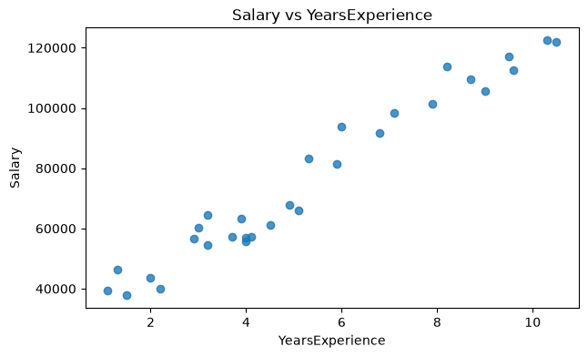
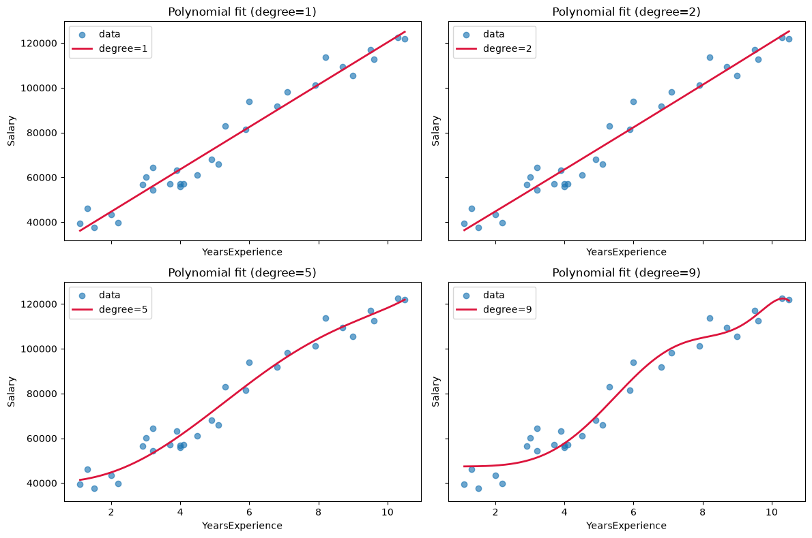
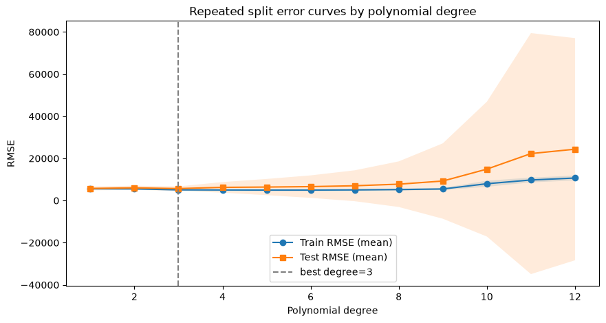
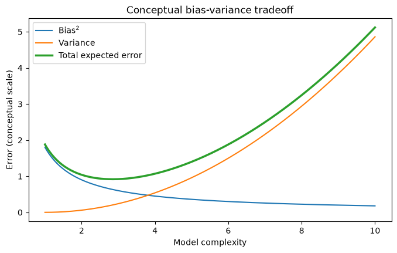
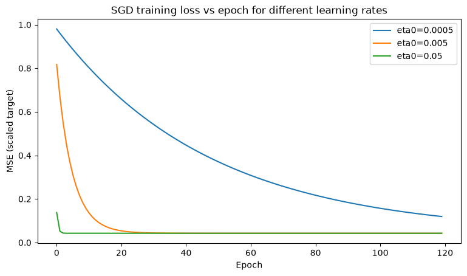
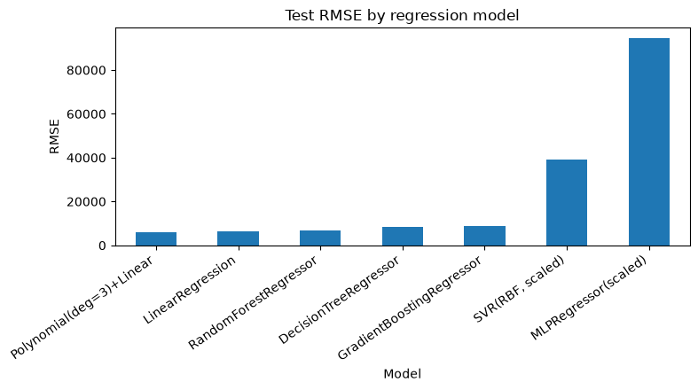
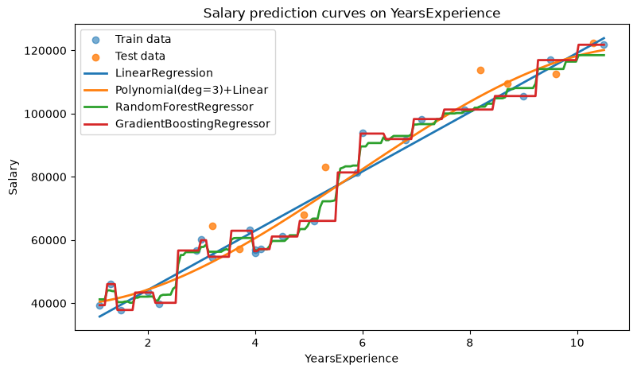
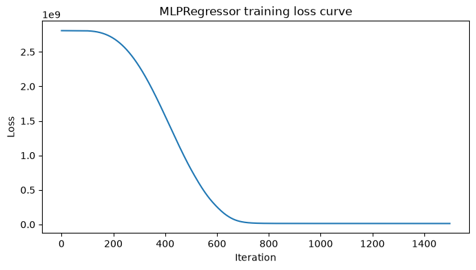
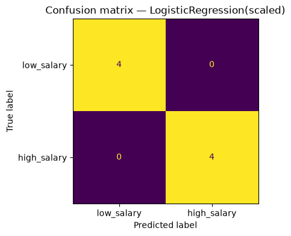

I am Greta and I hope that I can pass this course

## Homework 10_11 visualizations

### Raw data scatter

### Polynomial fits

### Train/test RMSE vs polynomial degree

### Conceptual bias-variance tradeoff

### Gradient-descent learning-rate curves

### Regression model comparison

### Salary prediction curves

### Neural-network loss curve

### Classification confusion matrix

